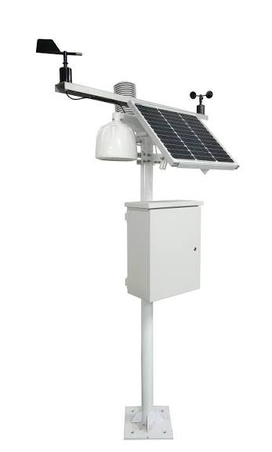
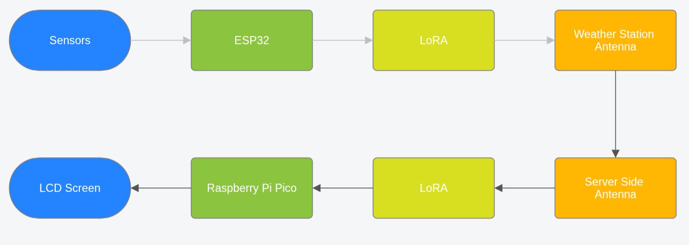

# OpenSky-Project

**GR**

Αυτό είναι το αποθετήριο για το πρότζεκτ **OpenSky**. Σκοπός μας είναι να δημιουργήσουμε σιγά σιγά μια λύση για να μπορείς να έχεις την δυνατότητα να χρησιμοποιείς αυτή τη συσκευή με κόστος όχι την πνευματική ιδιοκτησία αλλά τα έξοδα που θα έχουν τα φυσικά/ηλεκτρονικά κομμάτια της συσκευής. Θα έχεις την άδεια να χρησιμοποιήσεις/μεταποιήσεις τα αρχεία εφόσον είσαι και εσύ της φιλοσοφίας ανοιχτής πηγής (Open Source) και ακολουθείς τους κανόνες των άλλων αδειών που χρησιμοποιούμε. Εμείς είμαστε η φοιτητική ομάδα της ACM στο Αριστοτέλειο Πανεπιστήμιο Θεσσαλονίκης (AUTh) και ελπίζουμε να σου φανεί χρήσιμο. Για οποιεσδήποτε άλλες απορίες μην διστάσετε να μας ρωτήσετε.

Με τη σειρά, θα εξηγήσουμε μερικά πράγματα συμπεριλαμβανομένων:

1. Ευρετήριο Όρων
2. Σχεδιάγραμμα Αρχιτεκτονικής  
3. Κατάλογος Υλικών (BOM)
4. Συναρμολόγηση Συστήματος
5. Πηγές

Ευρετήριο όρων
---
Το **ευρετήριο** (φάκελος Index) έχει αρκετούς από τους βασικούς όρους στα ελληνικά και στα αγγλικά που χρησιμοποιούμε στο repo είτε τεχνικούς είτε όχι.

Σχεδιάγραμμα Αρχιτεκτονικής
---

Για την πρώτη έκδοση v0.1 θέλουμε να πετύχουμε ασύρματη επικοινωνία δύο υποσταθμών. Ο ένας είναι ο συλλογέας δεδομένων, όπου μέσω αισθητήρων θα μαζεύει τα δεδομένα ανά τακτά χρονικά διαστήματα (όχι real time για λόγους ενεργειακής απόδοσης) και θα τα στέλνει μέσω κεραίας και LoRa στον δεύτερο υποσταθμό που είναι ο server που λαμβάνει τα δεδομένα, τα επεξεργάζεται και τα δείχνει σε μια μικρή οθόνη OLED.   

Κατάλογος Υλικών (BOM)
---

Ο Κατάλογος Υλικών παρέχει λεπτομέρειες για κάθε ξεχωριστό αντικείμενο που χρησιμοποιήθηκε στο πρότζεκτ με ενδεικτική τιμή, αριθμό που χρησιμοποιήθηκαν, όνομα και κωδικό κατασκευαστή και υπερσυνδέσμους για άμεση αγορά από διεθνείς προμηθευτές. Περισσότερα στον φάκελο Bill-Of-Materials.

Συναρμολόγηση Συστήματος
---

Εφόσον έχεις αγοράσει τα υλικά από το **BOM** και τα έχεις παραλάβει τότε πρέπει και να συναρμολογήσεις το σύστημα. Για αυτό στον φάκελο Assembly-Tutorial μπορείς να βρεις διάφορα μικρά βιντεάκια τα οποία θα σε καθοδηγήσουν βήμα προς βήμα ώστε από το μηδέν να φτιάξεις το σύστημα.

Πηγές
---
Στις 27/09/2026 που γράφεται αυτή η ενημέρωση βρισκόμαστε στην έκδοση v0.1

**Copyright © 2026 ACM AUTh Student Chapter CERN Open Hardware Licence Version 2 - Strongly Reciprocal**

**Copyright © 2026 ACM AUTh Student Chapter The MIT License**

