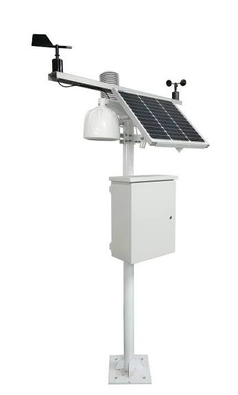

# Weather-Station-Project

This repository is available to you in Greek and English (GR/EN)

**GR**

Αυτό είναι το αποθετήριο για το πρότζεκτ του **Μετεωρολογικού Σταθμού**. Σκοπός μας είναι να δημιουργήσουμε σιγά σιγά μια λύση για να μπορείς να έχεις την δυνατότητα να χρησιμοποιείς αυτή τη συσκευή με κόστος όχι την πνευματική ιδιοκτησία αλλά τα έξοδα που θα έχουν τα φυσικά/ηλεκτρονικά κομμάτια της συσκευής. Θα έχεις την άδεια να χρησιμοποιήσεις/μεταποιήσεις τα αρχεία εφόσον είσαι και εσύ της φιλοσοφίας ανοιχτής πηγής (Open Source) και ακολουθείς τους κανόνες των άλλων αδειών που χρησιμοποιούμε. Εμείς είμαστε η φοιτητική ομάδα της ACM στο Αριστοτέλειο Πανεπιστήμιο Θεσσαλονίκης (AUTh) και ελπίζουμε να σου φανεί χρήσιμο. Για οποιεσδήποτε άλλες απορίες μην διστάσετε να μας ρωτήσετε.

Με τη σειρά, θα εξηγήσουμε μερικά πράγματα συμπεριλαμβανομένων:

1. Ευρετήριο Όρων
2. Σχεδιάγραμμα Αρχιτεκτονικής  
3. 
4. --
5. Κατάλογος Υλικών (BOM)
6. Πηγές

Στις 27/09/2026 που γράφεται αυτή η ενημέρωση βρισκόμαστε στην έκδοση v0.1

**ΕΝ**

This is the repository for the **Weather Station Project**. Our objective is to create, slowly and steadily, a solution for you to have the ability to use the device only with the costs of materials and free of any intellectual property. You are licensed to use/repurpose the files as long as you are of the Open Source philosophy yourself and adhere to the other licenses we are using. We are the official student team of ACM at Aristotle University of Thessaloniki (AUTh) and we hope you find this useful. For any other questions don't hesitate to ask us.

Here and in order we will explain some things including:

1. Index
2. Architecture Diagram
3. --
4. --
5. Bill Of Materials (BOM)
6. Resources

We are at version v0.1 at 27/09/2026 when this is updated

**Copyright © 2026 ACM AUTh Student Chapter CERN Open Hardware Licence Version 2 - Strongly Reciprocal**

**Copyright © 2026 ACM AUTh Student Chapter The MIT License**
