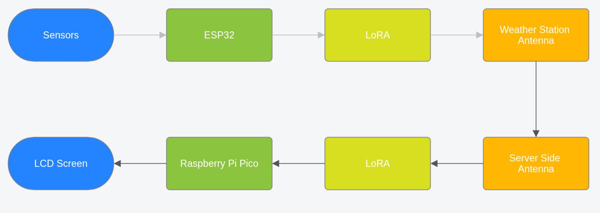

Weather Station
---

This is the **directory** which includes all the files regarding the project including code, CAD files, diagrams and more. 
This is v1.0 also known as Proof of Concept (PoC).

See below for the abstract diagram of this version.

more details as soon as we can provide them (28/09/2026)
